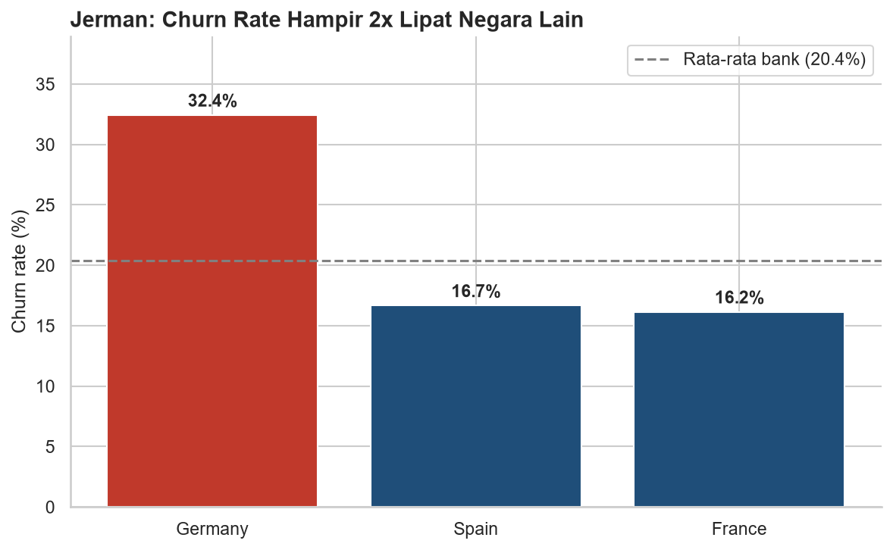
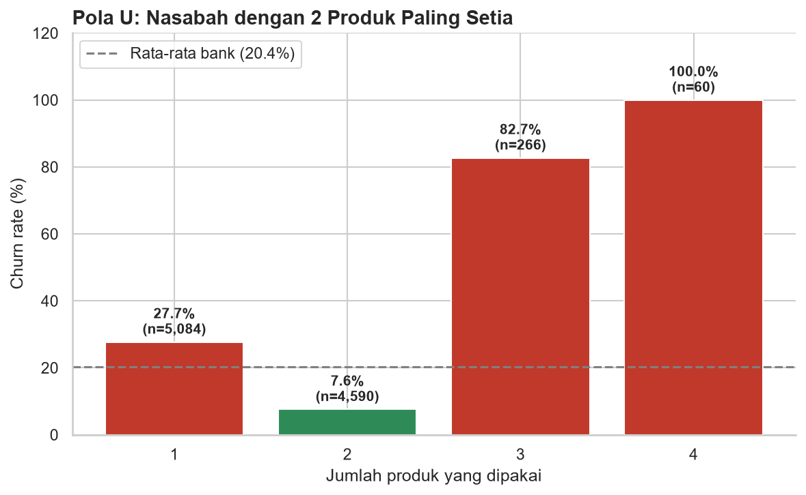
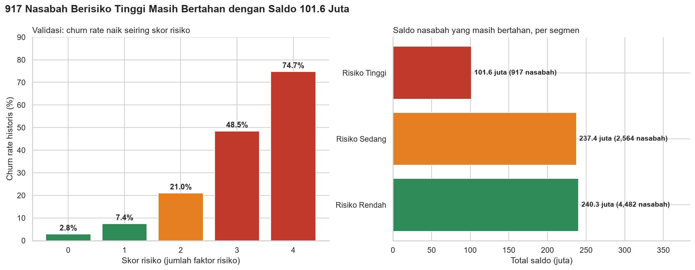

# Bank Customer Churn Analysis
### Siapa yang pergi, kenapa, dan berapa dana yang masih bisa diselamatkan?

**Tools:** PostgreSQL · Python (pandas, matplotlib, seaborn, SQLAlchemy) · Data Studio
**Dashboard interaktif:** [Bank Customer Churn Dashboard](https://datastudio.google.com/reporting/d1f28043-f933-4389-94f1-1789d9ea0fa6)

---

## Ringkasan Eksekutif

- Bank kehilangan **20,37%** nasabahnya (2.037 dari 10.000), yang membawa pergi saldo **185,6 juta**.
- Kebocoran terkonsentrasi: **Jerman** (churn 32,4%) dan **usia 40–59** (35% nasabah, tetapi 63% churn).
- Nasabah dengan **2 produk** paling setia (churn 7,6%); nasabah **tidak aktif** pergi hampir **2x** lebih sering.
- Skor risiko berbasis 4 faktor memisahkan nasabah dengan jelas: churn naik dari **2,8%** (skor 0) ke **74,7%** (skor 4).
- **917 nasabah berisiko tinggi masih bertahan** dengan saldo **101,6 juta**: daftar prioritas untuk program retensi.

---

## 1. Business Understanding

Bank memperoleh dana murah dari tabungan dan giro nasabah. Setiap nasabah yang pergi membawa saldonya, sehingga dana yang bisa disalurkan menjadi kredit ikut berkurang. Mempertahankan nasabah lama juga lebih murah daripada mencari nasabah baru.

**Masalah:** sekitar 1 dari 5 nasabah meninggalkan bank, dan manajemen belum tahu siapa yang perlu diprioritaskan.

**Pertanyaan bisnis:**
1. Seberapa besar churn dan berapa dana yang hilang?
2. Siapa yang paling sering pergi (negara, umur)?
3. Faktor apa yang berkaitan dengan churn (jumlah produk, keaktifan)?
4. Nasabah mana yang masih bertahan tetapi berisiko pergi, dan berapa saldo yang terancam?

---

## 2. Data Source

- **Dataset:** [Predicting Churn for Bank Customers](https://www.kaggle.com/datasets/adammaus/predicting-churn-for-bank-customers) (Kaggle)
- **Ukuran:** 10.000 nasabah, 14 kolom, 1 tabel
- **Negara:** Prancis, Spanyol, Jerman
- **Target:** `Exited` (1 = nasabah meninggalkan bank, 0 = bertahan)

---

## 3. Tech Stack & Alur Kerja

| Tahap | Tools | Output |
|---|---|---|
| Penyimpanan & cleaning | PostgreSQL (pgAdmin 4) | Tabel `customers`, cek kualitas data |
| Analisis | SQL (CTE, window function, CASE WHEN) | 7 query di `sql/03_analysis.sql` |
| Visualisasi | Python (pandas, seaborn) di Jupyter | 5 grafik di `images/` |
| Dashboard | Data Studio | Dashboard interaktif publik |

Python terhubung ke PostgreSQL lewat SQLAlchemy. Password database dimasukkan saat runtime dengan `getpass()`, sehingga tidak tersimpan di kode.

---

## 4. Data Quality Check

Semua pengecekan ada di [`sql/02_data_quality.sql`](sql/02_data_quality.sql).

| Pengecekan | Hasil |
|---|---|
| Jumlah baris setelah import | 10.000 (sesuai sumber) |
| Nilai NULL | Tidak ada |
| Duplikat `customer_id` | Tidak ada (dijaga PRIMARY KEY) |
| Rentang nilai | Wajar; saldo minimum 0 |
| Konsistensi kategori | 3 negara, penulisan konsisten |

**Catatan:**
- Uang disimpan sebagai `NUMERIC(12,2)`, bukan `FLOAT`, untuk menghindari selisih pembulatan.
- File CSV sempat rusak karena dibuka dan disimpan ulang di Excel (pemisah berubah menjadi titik koma dan titik desimal hilang). Masalah terdeteksi saat import dan diperbaiki dengan file asli. Pelajaran: data mentah tidak boleh diubah.
- Angka direkonsiliasi antara SQL, Python, dan dashboard. Satu kesalahan kondisi di query saldo terancam (`exited = 1` seharusnya `0`) ketahuan lewat rekonsiliasi ini dan sudah diperbaiki.

---

## 5. Feature Engineering

- **Kelompok umur:** 18–29, 30–39, 40–49, 50–59, 60+
- **Status keaktifan:** Aktif / Tidak Aktif
- **Skor risiko (0–4):** 1 poin untuk setiap faktor: tinggal di Jerman, berusia 40–59, memakai produk selain 2, dan tidak aktif
- **Segmen risiko:** Tinggi (skor 3–4), Sedang (skor 2), Rendah (skor 0–1)

Skor dibuat berbasis aturan (*rule-based*) agar mudah dijelaskan kepada manajemen.

---

## 6. Key Findings

### Temuan 1: Jerman, churn hampir 2x negara lain

| Negara | Nasabah | Churn rate |
|---|---|---|
| Jerman | 2.509 | **32,44%** |
| Spanyol | 2.477 | 16,67% |
| Prancis | 5.014 | 16,15% |

Jerman hanya ±25% nasabah, tetapi menyumbang lebih dari separuh saldo yang hilang. Semua nasabah Jerman punya saldo, sedangkan hampir separuh nasabah Prancis dan Spanyol bersaldo nol. Dibandingkan secara adil dengan nasabah bersaldo di negara lain (18,2% dan 19,6%), churn Jerman tetap ±1,7x lebih tinggi.

### Temuan 2: Risiko churn melonjak mulai usia 40

| Umur | Nasabah | Churn rate |
|---|---|---|
| 18–29 | 1.641 | 7,56% |
| 30–39 | 4.346 | 10,88% |
| 40–49 | 2.618 | 30,79% |
| 50–59 | 869 | **56,04%** |
| 60+ | 526 | 27,95% |

Usia 40–59 hanya 35% nasabah, tetapi menyumbang 63% churn. Kelompok 50–59 juga punya saldo rata-rata tertinggi.

### Temuan 3: Pola U, 2 produk paling setia

| Jumlah produk | Nasabah | Churn rate |
|---|---|---|
| 1 | 5.084 | 27,71% |
| 2 | 4.590 | **7,58%** |
| 3 | 266 | 82,71% |
| 4 | 60 | 100% |

Nasabah 1 produk menyumbang 69% dari seluruh churn. Kelompok 3–4 produk berisiko sangat tinggi, tetapi sampelnya kecil (326 nasabah), sehingga perlu diselidiki lebih lanjut.

### Temuan 4: Nasabah tidak aktif pergi hampir 2x lebih sering

Churn nasabah tidak aktif 26,85% vs 14,27% untuk nasabah aktif. Masih ada **3.547 nasabah tidak aktif yang bertahan** dengan saldo **255,6 juta**.

### Temuan 5: Skor risiko dan saldo yang terancam

| Skor | Nasabah | Churn historis | Masih bertahan | Saldo bertahan |
|---|---|---|---|---|
| 4 | 392 | 74,74% | 99 | 11,8 juta |
| 3 | 1.587 | 48,46% | 818 | 89,8 juta |
| 2 | 3.246 | 21,01% | 2.564 | 237,4 juta |
| 1 | 3.434 | 7,43% | 3.179 | 200,9 juta |
| 0 | 1.341 | 2,83% | 1.303 | 39,4 juta |

Churn naik konsisten seiring skor, sehingga skor ini layak dipakai sebagai alat prioritas. **917 nasabah berisiko tinggi (skor 3–4) masih bertahan dengan saldo 101,6 juta.**

---

## 7. Dashboard

**[Buka dashboard interaktif](https://datastudio.google.com/reporting/d1f28043-f933-4389-94f1-1789d9ea0fa6)**

Dashboard disusun sebagai satu alur cerita: KPI → siapa yang pergi (negara, umur) → kenapa pergi (produk, keaktifan) → siapa yang harus diselamatkan (skor risiko, saldo per segmen) → temuan dan rekomendasi.

---

## 8. Rekomendasi

| # | Target | Aksi | Ukuran keberhasilan |
|---|---|---|---|
| 1 | 917 nasabah Risiko Tinggi | Kontak personal oleh relationship manager dalam 30 hari | Churn 90 hari dan saldo yang bertahan, dibanding kelompok kontrol |
| 2 | 3.547 nasabah tidak aktif | Program aktivasi: pengingat transaksi, promo penggunaan aplikasi | % nasabah yang kembali aktif dalam 60 hari |
| 3 | Nasabah 1 produk | Cross-selling produk kedua yang relevan; hindari mendorong ke 3–4 produk | Adopsi produk kedua dan churn 6 bulan |
| 4 | Usia 40–59 dan Jerman | Survei dan exit interview untuk mencari penyebab; kaji produk pra-pensiun | Alasan churn yang teridentifikasi |

Setiap program sebaiknya diuji dengan **A/B test**: sebagian nasabah mendapat program, sebagian lain tidak (kelompok kontrol), agar dampaknya terukur adil.

---

## 9. Limitations

1. Data hanya satu titik waktu, tanpa riwayat transaksi.
2. Mata uang tidak disebutkan di dataset; angka saldo ditulis dalam satuan aslinya.
3. Skor risiko memakai bobot sama untuk setiap faktor, dibuat dan divalidasi pada data yang sama. Validasi pada data baru atau model machine learning bisa menjadi pengembangan berikutnya.
4. Kelompok 3–4 produk bersampel kecil (266 dan 60 nasabah).
5. Analisis menunjukkan hubungan, bukan sebab-akibat. Alasan seperti "pra-pensiun" masih berupa hipotesis.
6. Tidak ada nasabah Jerman bersaldo nol; penyebabnya tidak bisa dipastikan dari data.
7. Dataset berasal dari bank Eropa (publik, anonim), bukan bank di Indonesia.

---

## 10. Struktur Repository & Cara Menjalankan

    bank-churn-analysis/
    ├── data/          dataset mentah dan data untuk dashboard
    ├── sql/           create table, data quality, analisis
    ├── notebooks/     analisis dan visualisasi Python
    ├── images/        grafik dan screenshot dashboard
    ├── environment.yml
    └── README.md

1. Buat environment: `conda env create -f environment.yml`
2. Buat database `bank_churn` di PostgreSQL, jalankan `sql/01_create_table.sql`, lalu import `data/Churn_Modelling.csv`.
3. Jalankan `sql/02_data_quality.sql` dan `sql/03_analysis.sql`.
4. Buka `notebooks/churn_analysis.ipynb` dan jalankan semua sel.

---

## Kontak

**Gede Andhika Pratama Putra**
GitHub: [github.com/gede-andhika](https://github.com/gede-andhika)

Terbuka untuk kesempatan magang Data Analyst di industri perbankan.
