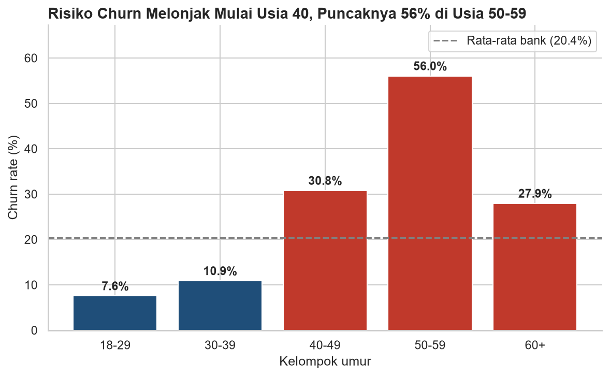
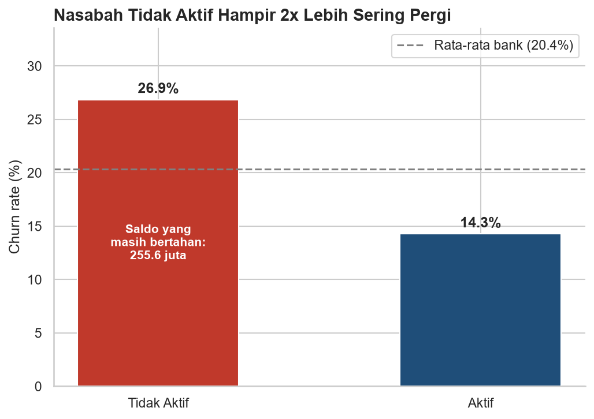
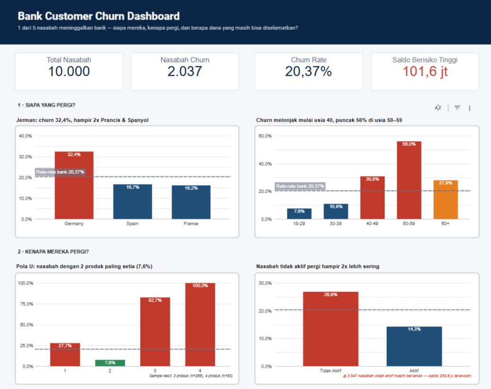
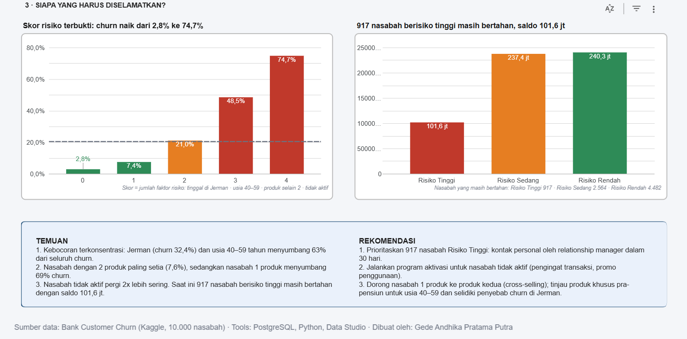

# Bank Customer Churn Analysis: Retensi Nasabah dan Saldo yang Terancam

> **Proyek analitik end-to-end** menggunakan PostgreSQL, Python (Jupyter), dan Data Studio untuk mengidentifikasi di mana nasabah bank paling banyak pergi, lalu memprioritaskan nasabah yang masih bertahan tetapi berisiko pergi berikutnya.

**Hasil utama:**
- Bank kehilangan **20,37%** nasabahnya (2.037 dari 10.000), dengan saldo **185,6 juta** ikut keluar.
- Kebocoran terkonsentrasi di **Jerman** (churn 32,4%) dan **usia 40–59 tahun** (35% nasabah, tetapi 63% dari seluruh churn).
- Nasabah dengan **2 produk** paling setia (churn 7,6%); nasabah **tidak aktif** pergi hampir **2x** lebih sering.
- Skor risiko dari 4 faktor memisahkan nasabah dengan jelas: churn naik dari **2,8%** (skor 0) ke **74,7%** (skor 4).
- **917 nasabah berisiko tinggi masih bertahan** dengan saldo **101,6 juta**: daftar prioritas untuk program retensi.

---

## Daftar Isi

1. [Business Understanding](#1-business-understanding)
2. [Data Source](#2-data-source)
3. [Tech Stack dan Alur Kerja](#3-tech-stack-dan-alur-kerja)
4. [Data Cleaning](#4-data-cleaning)
5. [Feature Engineering](#5-feature-engineering)
6. [Key Findings](#6-key-findings)
7. [Dashboard](#7-dashboard)
8. [Insight dan Rekomendasi Strategis](#8-insight-dan-rekomendasi-strategis)

Lampiran: [Limitations dan Catatan Metodologi](#limitations-dan-catatan-metodologi) · [Struktur Repository dan Cara Menjalankan](#struktur-repository-dan-cara-menjalankan)

---

## 1. Business Understanding

### 1.1 Latar Belakang Bisnis

Bank memperoleh dana murah dari tabungan dan giro nasabah, lalu menyalurkannya sebagai kredit. Setiap nasabah yang pergi membawa saldonya, sehingga dana yang bisa disalurkan ikut berkurang. Mempertahankan nasabah lama umumnya juga lebih murah daripada mencari nasabah baru.

Dataset berisi 10.000 nasabah sebuah bank di tiga negara Eropa (Prancis, Spanyol, Jerman). Setiap nasabah memiliki dua status utama:

- **Churn** (`Exited = 1`): nasabah sudah meninggalkan bank.
- **Bertahan** (`Exited = 0`): nasabah masih menjadi nasabah bank.

Nasabah juga dibedakan menjadi **aktif** dan **tidak aktif** (`IsActiveMember`), yaitu apakah nasabah aktif bertransaksi atau hanya memiliki rekening.

### 1.2 Masalah Bisnis

Manajemen menghadapi dua masalah yang saling terkait:

- **Masalah 1: Kebocoran nasabah dan dana.** Sekitar 1 dari 5 nasabah meninggalkan bank dan membawa saldo 185,6 juta. Belum diketahui di mana kebocoran itu terkonsentrasi.
- **Masalah 2: Dana yang masih bisa diselamatkan.** Dari 7.963 nasabah yang masih bertahan (total saldo 579,3 juta), belum jelas siapa yang paling berisiko pergi berikutnya. Tanpa prioritas, program retensi harus disebar ke semua nasabah.

### 1.3 Tujuan Proyek

| # | Tujuan | Fokus Analisis |
|---|---|---|
| 1 | Mengidentifikasi lokasi dan besaran kebocoran nasabah | Segmentasi churn: negara, umur, jumlah produk, keaktifan |
| 2 | Mengidentifikasi nasabah bertahan yang berisiko tinggi beserta nilai saldonya | Skor risiko dan saldo terancam |

### 1.4 Pertanyaan Bisnis (Key Business Questions)

**Tujuan 1: Kebocoran nasabah**

- Seberapa besar churn keseluruhan, dan berapa saldo yang hilang?
- Di negara dan kelompok umur mana nasabah paling sering pergi?
- Apakah jumlah produk yang dipakai dan status keaktifan berkaitan dengan churn?
- Apakah perbedaan antarnegara tetap ada jika dibandingkan secara adil (misalnya hanya nasabah bersaldo)?

**Tujuan 2: Prioritas retensi**

- Faktor mana yang bisa digabung menjadi skor risiko, dan apakah skor itu benar-benar memisahkan nasabah yang pergi dan yang bertahan?
- Berapa banyak nasabah berisiko tinggi yang masih bertahan, dan berapa saldo yang terancam?

---

## 2. Data Source

**Platform:** Kaggle
**Dataset:** [Predicting Churn for Bank Customers](https://www.kaggle.com/datasets/adammaus/predicting-churn-for-bank-customers) (`Churn_Modelling.csv`)
**Ukuran:** 10.000 baris, 14 kolom, 1 tabel (`customers`)

| Kolom | Keterangan | Tipe di PostgreSQL | Dipakai di analisis |
|---|---|---|---|
| `row_number` | Nomor baris | INT | Tidak |
| `customer_id` | ID nasabah (PRIMARY KEY) | BIGINT | Ya (identitas) |
| `surname` | Nama belakang nasabah | VARCHAR(50) | Tidak |
| `credit_score` | Skor kredit | INT | Tidak |
| `geography` | Negara (Prancis, Spanyol, Jerman) | VARCHAR(20) | Ya |
| `gender` | Jenis kelamin | VARCHAR(10) | Hanya diekspor |
| `age` | Umur | INT | Ya |
| `tenure` | Lama menjadi nasabah (tahun) | INT | Hanya diekspor |
| `balance` | Saldo rekening | NUMERIC(12,2) | Ya |
| `num_of_products` | Jumlah produk bank yang dipakai (1–4) | INT | Ya |
| `has_cr_card` | Punya kartu kredit (1/0) | SMALLINT | Tidak |
| `is_active_member` | Nasabah aktif bertransaksi (1/0) | SMALLINT | Ya |
| `estimated_salary` | Perkiraan gaji | NUMERIC(12,2) | Tidak |
| `exited` | Status churn (target) | SMALLINT | Ya |

**Rentang waktu:** dataset tidak punya kolom tanggal; data adalah potret satu titik waktu.
**Mata uang:** tidak disebutkan di dataset, sehingga saldo ditulis dalam satuan aslinya.
**Privasi:** dataset publik dan sudah dianonimkan. Kolom `surname` tidak ikut diekspor ke dashboard.

---

## 3. Tech Stack dan Alur Kerja

**Alur:** Kaggle (CSV) → PostgreSQL → Python (Jupyter) → CSV hasil olahan → Data Studio

| Tahap | Tools | Output |
|---|---|---|
| Penyimpanan dan validasi data | PostgreSQL (pgAdmin 4) | Tabel `customers`, cek kualitas data |
| Analisis | SQL (CTE, window function, CASE WHEN) | 7 query di `sql/03_analysis.sql` |
| Visualisasi dan rekonsiliasi | Python (pandas, matplotlib, seaborn) di Jupyter | 5 grafik di `images/` |
| Dashboard | Data Studio | Dashboard interaktif publik |

**Koneksi:** Python terhubung langsung ke PostgreSQL lewat SQLAlchemy. Password database dimasukkan saat dijalankan dengan `getpass()`, sehingga tidak tersimpan di kode. Dashboard membaca file `data/churn_dashboard.csv` hasil olahan Python (tanpa kolom nama nasabah).

---

## 4. Data Cleaning

Semua pengecekan dilakukan di PostgreSQL dan tersimpan di [`sql/02_data_quality.sql`](sql/02_data_quality.sql). Hasilnya: data bersih, dan tidak ada baris yang dihapus atau diubah.

### 4.1 Strategi Validasi

| Pengecekan | Cara | Hasil |
|---|---|---|
| Jumlah baris setelah import | `COUNT(*)` dibandingkan dengan file sumber | 10.000 baris, sama dengan sumber |
| Nilai kosong (NULL) | `COUNT(*) - COUNT(kolom)` untuk setiap kolom | Tidak ada NULL |
| Duplikat `customer_id` | `GROUP BY` + `HAVING COUNT(*) > 1`, dijaga juga oleh PRIMARY KEY | Tidak ada duplikat |
| Rentang nilai | `MIN` dan `MAX` untuk umur, skor kredit, lama menjadi nasabah, saldo, jumlah produk | Wajar; saldo minimum 0 |
| Konsistensi kategori | `GROUP BY geography` | 3 negara, penulisan konsisten |

### 4.2 Keputusan Desain Data

- **Uang disimpan sebagai `NUMERIC(12,2)`, bukan `FLOAT`.** `FLOAT` menyimpan angka secara perkiraan dan bisa menimbulkan selisih pembulatan; untuk data uang, selisih sekecil apa pun tidak bisa diterima.
- **`customer_id` sebagai PRIMARY KEY.** Database otomatis menolak data ganda.
- **Saldo nol dipertahankan.** Nasabah bersaldo nol bukan error data, dan justru menjelaskan perbedaan antarnegara (lihat Temuan 1 dan Temuan 6).
- **Data minimization.** Nama nasabah tidak diekspor ke dashboard karena tidak dibutuhkan untuk analisis.

### 4.3 Insiden Kualitas Data dan Pelajarannya

1. **CSV rusak karena dibuka di Excel.** File sempat tersimpan ulang oleh Excel dengan pengaturan bahasa Indonesia: pemisah kolom berubah menjadi titik koma dan titik desimal hilang (gaji 101348.88 menjadi 10134888, atau 100 kali lipat). PostgreSQL menolak import karena tipe datanya ketat, sehingga kesalahan ketahuan sebelum analisis. File diganti dengan versi asli. **Pelajaran:** data mentah tidak boleh dibuka dan disimpan ulang di Excel.
2. **Kesalahan kondisi di query saldo terancam.** Kondisi `exited = 1` seharusnya `exited = 0`. Kesalahan ketahuan karena total kolom itu (185,59 juta) sama persis dengan total saldo hilang di query lain. Setelah diperbaiki, total saldo nasabah bertahan menjadi 579.270.798,25 dan cocok dengan query berbeda. **Pelajaran:** selalu rekonsiliasi angka antar-query.
3. **Rekonsiliasi lintas tools.** Angka utama (jumlah nasabah, churn, churn rate, saldo risiko tinggi) dicocokkan antara SQL, Python, dan dashboard.

---

## 5. Feature Engineering

### 5.1 Pengelompokan (Binning) dan Label

| Fitur baru | Aturan | Tujuan |
|---|---|---|
| `kelompok_umur` | 18–29, 30–39, 40–49, 50–59, 60+ | Menghindari puluhan baris umur dengan sampel kecil |
| `status_keaktifan` | `is_active_member` 1 = Aktif, 0 = Tidak Aktif | Label yang mudah dibaca manajemen |
| `status_churn` | `exited` 1 = Churn, 0 = Bertahan | Label untuk dashboard |

### 5.2 Skor Risiko Churn

Skor dibuat dari 4 faktor yang masing-masing sudah terbukti berkaitan dengan churn di analisis sebelumnya. Setiap faktor bernilai 1 poin, sehingga skor berkisar 0–4.

| Faktor | Dasar temuan | Poin |
|---|---|---|
| Tinggal di Jerman | Churn 32,44% (Temuan 1) | +1 |
| Berusia 40–59 tahun | Churn 30,79% dan 56,04% (Temuan 2) | +1 |
| Memakai jumlah produk selain 2 | Nasabah 2 produk paling setia (Temuan 3) | +1 |
| Tidak aktif | Churn 26,85% vs 14,27% (Temuan 4) | +1 |

| Segmen | Skor |
|---|---|
| Risiko Tinggi | 3–4 |
| Risiko Sedang | 2 |
| Risiko Rendah | 0–1 |

Implementasi di SQL (CTE) pada query 7 di [`sql/03_analysis.sql`](sql/03_analysis.sql):

```sql
WITH skor AS (
    SELECT *,
        (CASE WHEN geography = 'Germany' THEN 1 ELSE 0 END
       + CASE WHEN age BETWEEN 40 AND 59 THEN 1 ELSE 0 END
       + CASE WHEN num_of_products <> 2  THEN 1 ELSE 0 END
       + CASE WHEN is_active_member = 0  THEN 1 ELSE 0 END) AS skor_risiko
    FROM customers
)
SELECT skor_risiko, COUNT(*) AS total_nasabah,
       ROUND(AVG(exited) * 100, 2) AS churn_rate_persen
FROM skor
GROUP BY skor_risiko
ORDER BY skor_risiko DESC;
```

> **Catatan metodologi:** skor dibuat berbasis aturan (*rule-based*) agar mudah dijelaskan kepada manajemen dan regulator. Faktor dipilih setelah melihat pola churn pada data yang sama, dan semua faktor berbobot sama. Validasi pada data baru belum dilakukan (lihat Limitations).

### 5.3 Metrik Turunan

| Metrik | Definisi |
|---|---|
| Churn rate | `SUM(exited) / COUNT(*)` (dalam kolom 0/1, rata-rata sama dengan proporsi) |
| Saldo hilang | `SUM(balance)` untuk `exited = 1` |
| Saldo terancam | `SUM(balance)` untuk `exited = 0` pada segmen yang dianalisis. Ini **eksposur** dana, bukan prediksi kerugian |
| Porsi populasi vs porsi churn | Persentase nasabah suatu kelompok dibandingkan persentase churn yang disumbangkannya |

### 5.4 File Analisis Akhir

| File | Isi | Dipakai untuk |
|---|---|---|
| [`sql/01_create_table.sql`](sql/01_create_table.sql) | Definisi tabel `customers` | Membuat ulang database |
| [`sql/02_data_quality.sql`](sql/02_data_quality.sql) | 5 pengecekan kualitas data | Bagian 4 |
| [`sql/03_analysis.sql`](sql/03_analysis.sql) | 7 query analisis (churn keseluruhan, negara, umur, produk, keaktifan, saldo nol, skor risiko) | Bagian 6 |
| [`notebooks/churn_analysis.ipynb`](notebooks/churn_analysis.ipynb) | Koneksi ke PostgreSQL, 5 grafik, skor risiko, ekspor data | Bagian 6 dan 7 |
| `data/churn_dashboard.csv` | 13 kolom hasil olahan, tanpa nama nasabah | Sumber data dashboard |

---

## 6. Key Findings

Analisis dilakukan di PostgreSQL (query pada `sql/03_analysis.sql`), lalu direplikasi dan divisualisasikan di Python. Notebook lengkap: [`churn_analysis.ipynb`](notebooks/churn_analysis.ipynb).

---

### Temuan 1: Jerman Menyumbang Lebih dari Separuh Saldo yang Hilang, Padahal Hanya 25% Nasabah


| Negara | Nasabah | Churn | Churn rate | Saldo hilang | Porsi saldo hilang |
|---|---|---|---|---|---|
| Jerman | 2.509 | 814 | **32,44%** | 97,97 juta | **52,8%** |
| Spanyol | 2.477 | 413 | 16,67% | 29,95 juta | 16,1% |
| Prancis | 5.014 | 810 | 16,15% | 57,67 juta | 31,1% |

**Perbandingan yang adil (nasabah bersaldo vs saldo nol):**

| Negara | Ada saldo: nasabah | Ada saldo: churn rate | Saldo nol: nasabah | Saldo nol: churn rate |
|---|---|---|---|---|
| Jerman | 2.509 | **32,44%** | tidak ada | tidak ada |
| Prancis | 2.596 | 18,22% | 2.418 | 13,94% |
| Spanyol | 1.278 | 19,56% | 1.199 | 13,59% |

**Insight:**
- Churn Jerman hampir 2x Prancis dan Spanyol. Jerman hanya 25% nasabah, tetapi menyumbang 52,8% saldo yang hilang.
- Nasabah Jerman yang pergi rata-rata membawa ±120 ribu per orang, sedangkan di Prancis dan Spanyol ±71–73 ribu.
- Seluruh nasabah Jerman punya saldo, sedangkan hampir separuh nasabah Prancis dan Spanyol bersaldo nol. Karena itu rata-rata saldo Jerman terlihat lebih tinggi. Pertanyaannya: apakah churn Jerman tinggi hanya karena perbedaan komposisi ini?
- **Jawabannya tidak.** Dibandingkan hanya dengan nasabah bersaldo di negara lain (18,2% dan 19,6%), churn Jerman tetap ±1,7x lebih tinggi.

**Kenapa penting:** Kebocoran dana terbesar berasal dari satu pasar, dan sebabnya bukan sekadar efek komposisi nasabah. Jerman layak menjadi prioritas penyelidikan penyebab churn (lihat Rekomendasi 8.6).

---

### Temuan 2: Risiko Churn Melonjak Mulai Usia 40 dan Memuncak 56% di Usia 50–59



| Umur | Nasabah | Churn | Churn rate | Rata-rata saldo |
|---|---|---|---|---|
| 18–29 | 1.641 | 124 | 7,56% | 73.699 |
| 30–39 | 4.346 | 473 | 10,88% | 75.072 |
| 40–49 | 2.618 | 806 | **30,79%** | 78.479 |
| 50–59 | 869 | 487 | **56,04%** | **83.633** |
| 60+ | 526 | 147 | 27,95% | 75.136 |

**Insight:**
- Di bawah 40 tahun, churn jauh di bawah rata-rata bank (7–11%). Mulai 40-an, churn naik hampir 3x dan memuncak di 50-an.
- Usia 40–59 hanya 35% nasabah (3.487), tetapi menyumbang 63% dari seluruh churn (1.293 dari 2.037).
- Kelompok 50–59 memiliki rata-rata saldo tertinggi sekaligus churn tertinggi: bank kehilangan nasabah yang rata-rata paling bernilai.
- Churn turun lagi di 60+ (27,95%), tetapi masih di atas rata-rata bank.
- Kelompok 30–39 adalah segmen terbesar (4.346 nasabah) dan relatif stabil.

**Kenapa penting:** Masalah retensi bukan tersebar merata, melainkan terkonsentrasi di tahap kehidupan tertentu. Hipotesis yang perlu diuji: kebutuhan finansial usia 40–59 (misalnya persiapan pensiun) belum terlayani. Data ini menunjukkan *apa* yang terjadi, bukan *kenapa*.

---

### Temuan 3: Pola U, Nasabah dengan 2 Produk Paling Setia (7,6%)


| Jumlah produk | Nasabah | Churn | Churn rate |
|---|---|---|---|
| 1 | 5.084 | 1.409 | 27,71% |
| 2 | 4.590 | 348 | **7,58%** |
| 3 | 266 | 220 | 82,71% |
| 4 | 60 | 60 | 100% |

**Insight:**
- Teori umum "makin banyak produk, makin setia" hanya benar sampai 2 produk. Hubungannya berbentuk huruf U.
- Nasabah 2 produk punya churn 7,58%, sepertiga dari rata-rata bank.
- Nasabah 1 produk adalah sumber churn terbesar secara jumlah: 69% dari seluruh churn (1.409 dari 2.037).
- Kelompok 3–4 produk punya churn sangat tinggi (83–100%), tetapi hanya 326 nasabah (3,3% dari total). Angka 100% dari 60 orang terlalu sempurna untuk diambil sebagai kesimpulan kuat.

**Kenapa penting:** Peluang cross-selling terbesar ada pada nasabah 1 produk, dengan target **produk kedua, bukan sebanyak mungkin produk**. Perbedaan churn antara 1 dan 2 produk bisa saja muncul karena nasabah yang sudah setia lebih mudah mengambil produk kedua, sehingga hubungan sebab-akibatnya harus diuji lewat eksperimen (Rekomendasi 8.5).

---

### Temuan 4: Nasabah Tidak Aktif Pergi Hampir 2x Lebih Sering, dan 3.547 di Antaranya Masih Bertahan



| Status | Nasabah | Churn | Churn rate | Saldo nasabah yang bertahan |
|---|---|---|---|---|
| Tidak Aktif | 4.849 | 1.302 | **26,85%** | **255,6 juta** |
| Aktif | 5.151 | 735 | 14,27% | 323,7 juta |

**Insight:**
- Nasabah tidak aktif berisiko pergi sekitar 1,9x dibanding nasabah aktif.
- Mereka hanya ±48% dari seluruh nasabah, tetapi menyumbang ±64% dari churn.
- Masih ada **3.547 nasabah tidak aktif yang belum pergi** (4.849 − 1.302), dengan saldo **255,6 juta**: 44% dari seluruh dana nasabah yang bertahan.

**Kenapa penting:** Temuan 1–3 menjelaskan apa yang sudah hilang. Temuan ini menunjukkan sinyal peringatan dini pada nasabah yang masih bisa diselamatkan: nasabah biasanya tidak langsung menutup rekening, tetapi mulai jarang bertransaksi lebih dulu.

---

### Temuan 5: 917 Nasabah Berisiko Tinggi Masih Bertahan dengan Saldo 101,6 Juta


**Validasi skor (seluruh 10.000 nasabah):**

| Skor | Nasabah | Churn rate historis | Masih bertahan | Saldo bertahan |
|---|---|---|---|---|
| 4 | 392 | **74,74%** | 99 | 11,8 juta |
| 3 | 1.587 | 48,46% | 818 | 89,8 juta |
| 2 | 3.246 | 21,01% | 2.564 | 237,4 juta |
| 1 | 3.434 | 7,43% | 3.179 | 200,9 juta |
| 0 | 1.341 | **2,83%** | 1.303 | 39,4 juta |

**Segmen nasabah yang masih bertahan (7.963 nasabah, saldo 579,3 juta):**

| Segmen | Skor | Nasabah | Porsi nasabah | Saldo | Porsi saldo |
|---|---|---|---|---|---|
| Risiko Tinggi | 3–4 | **917** | 11,5% | **101,6 juta** | 17,5% |
| Risiko Sedang | 2 | 2.564 | 32,2% | 237,4 juta | 41,0% |
| Risiko Rendah | 0–1 | 4.482 | 56,3% | 240,3 juta | 41,5% |

**Insight:**
- Churn rate naik konsisten seiring skor, dari 2,83% (skor 0) ke 74,74% (skor 4): selisih ±26x. Skor ini valid sebagai alat prioritas.
- Dengan fokus pada **917 nasabah (11,5% dari nasabah bertahan)**, bank menjangkau **17,5% dari dana yang bertahan**.
- Tim retensi tidak mungkin menghubungi 7.963 nasabah satu per satu, tetapi 917 nasabah realistis ditangani secara personal.

**Kenapa penting:** Ini jembatan dari analisis ke tindakan. Angka 101,6 juta adalah **eksposur** (dana milik nasabah berisiko tinggi), bukan perkiraan kerugian. Churn historis menggambarkan nasabah yang sudah pergi, dan tidak otomatis berarti nasabah yang masih bertahan dengan ciri serupa akan pergi dengan peluang yang sama.

---

### Temuan 6: Anomali Data yang Perlu Diwaspadai

**1. Tidak ada nasabah Jerman bersaldo nol**, sedangkan hampir separuh nasabah Prancis (48%) dan Spanyol (48%) bersaldo nol. Penyebab tidak bisa dipastikan dari data: bisa karena perbedaan kebijakan bank atau cara pengumpulan data.

**2. Hipotesis awal ditolak oleh data.** Dugaan awal: saldo nol adalah tanda nasabah akan pergi. Hasilnya sebaliknya: di Prancis dan Spanyol, nasabah bersaldo nol justru lebih setia (13,9% dan 13,6%) dibanding nasabah bersaldo (18,2% dan 19,6%). Karena itu saldo nol **tidak dipakai** sebagai faktor skor risiko.

**3. Churn 100% pada kelompok 4 produk (n = 60)** terlalu sempurna untuk data nyata dan perlu diselidiki sebelum dijadikan dasar keputusan.

**4. Tidak ada dimensi waktu.** Data tidak menunjukkan kapan nasabah pergi, sehingga urutan perilaku sebelum churn (misalnya saldo menurun bertahap) tidak bisa dianalisis.

**Kenapa penting:** Hasil analisis hanya sekuat data yang mendasarinya. Mencatat anomali secara terbuka membuat temuan lain lebih bisa dipercaya.

---

## 7. Dashboard

Dashboard dirancang sebagai satu alur cerita, dari masalah sampai prioritas tindakan, bukan sebagai alat monitoring harian.

🔗 [Buka dashboard di Data Studio →](https://datastudio.google.com/reporting/d1f28043-f933-4389-94f1-1789d9ea0fa6)




**Tata letak:**
- **Baris atas:** 4 kartu KPI (total nasabah, nasabah churn, churn rate, saldo berisiko tinggi). Ringkasan eksekutif sebelum membaca grafik.
- **Bagian 1, "Siapa yang pergi?":** churn per negara (kiri) dan per kelompok umur (kanan).
- **Bagian 2, "Kenapa mereka pergi?":** churn per jumlah produk (kiri) dan per status keaktifan (kanan).
- **Bagian 3, "Siapa yang harus diselamatkan?":** validasi skor risiko (kiri) dan saldo nasabah bertahan per segmen risiko (kanan).
- **Bagian bawah:** kotak temuan dan rekomendasi, serta sumber data.

**Prinsip desain:** merah hanya untuk masalah, hijau untuk kondisi aman atau titik ideal, biru untuk kondisi normal. Setiap judul grafik berisi kesimpulan, dan garis putus-putus menunjukkan rata-rata bank (20,37%) sebagai pembanding.

---

## 8. Insight dan Rekomendasi Strategis

> *Rekomendasi di bawah didasarkan pada pola yang teramati dalam dataset. Angka saldo menunjukkan eksposur historis, bukan proyeksi kerugian atau pemulihan. Hasil yang diharapkan dari setiap program dirumuskan sebagai hipotesis yang perlu diuji lewat eksperimen.*

### 8.1 Ringkasan Temuan

**Tujuan 1: Kebocoran nasabah**

1. **Kebocoran terkonsentrasi.** Jerman (churn 32,4%) dan usia 40–59 (churn 31–56%) adalah titik masalah utama. Usia 40–59 hanya 35% nasabah, tetapi menyumbang 63% churn.
2. **Pola produk berbentuk U.** Nasabah 2 produk paling setia (7,6%), sedangkan nasabah 1 produk menyumbang 69% churn.
3. **Keaktifan adalah peringatan dini.** Nasabah tidak aktif pergi hampir 2x lebih sering.

**Tujuan 2: Prioritas retensi**

1. **Skor risiko valid.** Churn historis naik dari 2,8% ke 74,7% seiring skor.
2. **Daftar prioritas jelas.** 917 nasabah berisiko tinggi masih bertahan, dengan saldo 101,6 juta.
3. **Tidak perlu menjangkau semua nasabah.** Fokus pada 11,5% nasabah bertahan menjangkau 17,5% dana yang bertahan.

### 8.2 Apa yang Kita Ketahui tentang Dana yang Terancam

| Kelompok (masih bertahan) | Nasabah | Saldo | Porsi saldo bertahan | Status |
|---|---|---|---|---|
| Risiko Tinggi (skor 3–4) | 917 | 101,6 juta | 17,5% | Prioritas utama |
| Tidak aktif | 3.547 | 255,6 juta | 44,1% | Sinyal peringatan dini |

> Kedua kelompok **saling tumpang tindih**, sehingga angkanya tidak boleh dijumlahkan.

**Artinya:** angka di atas adalah dana yang saat ini dimiliki nasabah berisiko, bukan perkiraan berapa yang akan hilang. Berapa persen yang benar-benar akan pergi tidak bisa dihitung dari data satu titik waktu, dan itulah yang harus diukur oleh eksperimen di bawah.

### 8.3 Pilar 1: Perlindungan Nasabah Risiko Tinggi

**Masalah:** 917 nasabah berisiko tinggi masih bertahan, dan sinyal risikonya sudah jelas.

**Pendekatan:** program kecil dan terarah, diuji dengan kelompok kontrol sebelum diperluas.

| Elemen | Detail |
|---|---|
| Hipotesis | Kontak personal oleh relationship manager menurunkan churn nasabah berisiko tinggi |
| Target | 917 nasabah bertahan dengan skor 3–4 |
| Desain | A/B test. Kelompok A: kontrol, tanpa kontak khusus. Kelompok B: kontak personal dalam 30 hari |
| Unit randomisasi | Nasabah (`customer_id`), pembagian acak 50/50 |
| Metrik utama | Churn dalam 90 hari |
| Metrik pendukung | Total saldo yang bertahan di tiap kelompok |
| Guardrail | Keluhan nasabah tidak meningkat; biaya per kontak sesuai anggaran |
| Ambang sukses | Churn kelompok B lebih rendah dari kelompok A secara bermakna secara statistik |
| Catatan ukuran sampel | 917 nasabah relatif kecil. Jika kekuatan uji tidak cukup, perluas ke skor 2 (2.564 nasabah) |
| Exit criteria | Jika tidak ada penurunan churn setelah 90 hari, hentikan kontak personal dan evaluasi pendekatan lain |

### 8.4 Pilar 2: Aktivasi Nasabah Tidak Aktif

**Masalah:** 3.547 nasabah tidak aktif masih bertahan (saldo 255,6 juta) dan berisiko pergi hampir 2x dibanding nasabah aktif.

**Pendekatan:** komunikasi otomatis berbiaya rendah yang mendorong nasabah kembali bertransaksi.

| Elemen | Detail |
|---|---|
| Hipotesis | Program aktivasi mengembalikan nasabah tidak aktif menjadi aktif dan menurunkan churn |
| Target | 3.547 nasabah tidak aktif yang bertahan; mulai dari yang juga berskor risiko tinggi |
| Desain | A/B test 50/50. Kelompok A: tanpa program. Kelompok B: pengingat transaksi dan insentif pemakaian |
| Metrik utama | Persentase nasabah yang kembali aktif dalam 60 hari (definisi "aktif" mengikuti kebijakan bank) |
| Metrik lanjutan | Churn dalam 90 hari |
| Guardrail | Tingkat berhenti menerima komunikasi tidak meningkat; biaya insentif per nasabah yang kembali aktif |
| Ambang sukses | Tingkat aktivasi kelompok B lebih tinggi dari kelompok A |
| Exit criteria | Jika aktivasi tidak meningkat, uji kanal lain (notifikasi aplikasi atau telepon) atau insentif yang berbeda |

### 8.5 Pilar 3: Cross-Selling Produk Kedua

**Masalah:** nasabah 1 produk menyumbang 69% churn, sedangkan nasabah 2 produk paling setia. Di dataset ini ada 3.675 nasabah 1 produk yang masih bertahan (5.084 − 1.409).

**Catatan penting:** nasabah yang sudah setia mungkin lebih mudah mengambil produk kedua. Karena itu, hubungan "produk kedua menurunkan churn" harus dibuktikan lewat eksperimen, bukan diasumsikan dari data ini.

| Elemen | Detail |
|---|---|
| Hipotesis | Nasabah 1 produk yang mengambil produk kedua yang relevan lebih jarang pergi |
| Target | Nasabah 1 produk yang masih bertahan |
| Desain | A/B test. Kelompok A: tanpa penawaran. Kelompok B: penawaran produk kedua sesuai profil nasabah |
| Metrik utama | Adopsi produk kedua dalam 90 hari |
| Metrik lanjutan | Churn dalam 6 bulan |
| Guardrail | **Tidak mendorong ke 3 produk atau lebih** (churn 83–100%); keluhan dan pembatalan produk tidak meningkat |
| Exit criteria | Jika adopsi rendah atau churn tidak turun, tinjau kecocokan produk dengan kebutuhan nasabah |

### 8.6 Pilar 4: Menyelidiki Penyebab (Bukan Eksperimen)

Data hanya menunjukkan *apa* yang terjadi. Tiga pertanyaan berikut membutuhkan data tambahan.

| Fokus | Pertanyaan | Cara | Output |
|---|---|---|---|
| Jerman | Kenapa churn 2x negara lain, bahkan setelah dibandingkan secara adil? | Survei dan exit interview; bandingkan biaya, suku bunga, dan layanan dengan pesaing lokal | Daftar alasan churn utama |
| Usia 40–59 | Kebutuhan apa yang belum terlayani? | Survei; kaji produk pra-pensiun (hipotesis) | Kebutuhan yang diprioritaskan |
| 3–4 produk | Kenapa hampir semua nasabah pergi? | Audit paket produk, biaya, dan proses penjualan | Ada atau tidaknya masalah penjualan produk |

### 8.7 Yang Tidak Akan Dilakukan (dan Alasannya)

- **Tidak mendorong nasabah ke 3–4 produk.** Churn kelompok ini 83–100%, dan sampelnya kecil. Target yang aman adalah 2 produk.
- **Tidak memperlakukan saldo nol sebagai tanda akan pergi.** Data menunjukkan sebaliknya di Prancis dan Spanyol.
- **Tidak memberi insentif massal ke seluruh nasabah.** 56% nasabah bertahan berisiko rendah; fokus pada 917 nasabah berisiko tinggi lebih efisien.
- **Tidak menyimpulkan penyebab churn dari data ini saja.** Alasan seperti "persiapan pensiun" masih hipotesis.

### 8.8 Exit Criteria

Rekomendasi tanpa exit criteria adalah komitmen tanpa syarat.

| Program | Lanjutkan jika | Sesuaikan jika | Hentikan jika |
|---|---|---|---|
| Kontak personal (risiko tinggi) | Churn 90 hari lebih rendah dari kontrol | Penurunan kecil atau belum meyakinkan | Tidak ada perbedaan setelah 90 hari |
| Aktivasi nasabah tidak aktif | Tingkat aktivasi lebih tinggi dari kontrol | Aktivasi naik tetapi biaya insentif tinggi | Aktivasi tidak naik, atau komunikasi memicu penolakan |
| Cross-selling produk kedua | Adopsi naik tanpa lonjakan keluhan | Adopsi naik tetapi churn belum turun | Keluhan atau pembatalan produk meningkat |

---

## Limitations dan Catatan Metodologi

1. **Data satu titik waktu.** Tidak ada riwayat transaksi atau tanggal churn, sehingga urutan perilaku sebelum churn tidak bisa dilihat.
2. **Hubungan, bukan sebab-akibat.** Alasan seperti "persiapan pensiun" adalah hipotesis, bukan temuan.
3. **Skor risiko divalidasi pada data yang sama.** Faktor dipilih setelah melihat pola churn pada data ini (*in-sample*), dengan bobot sama. Pengembangan berikutnya: validasi pada data terpisah (train/test) atau model seperti regresi logistik.
4. **Churn historis bukan peluang nasabah bertahan.** Churn rate menggambarkan kelompok yang sudah pergi. Peluang nasabah yang masih bertahan untuk pergi bisa berbeda. "Saldo terancam" adalah eksposur, bukan prediksi kerugian.
5. **Sampel kecil pada 3–4 produk** (266 dan 60 nasabah), sehingga angka 83% dan 100% perlu diselidiki lebih lanjut.
6. **Mata uang tidak diketahui.** Saldo ditulis dalam satuan aslinya.
7. **Anomali Jerman:** tidak ada nasabah bersaldo nol, dan penyebabnya tidak bisa dipastikan dari data.
8. **Dataset bank Eropa (publik dan anonim).** Belum tentu mewakili perilaku nasabah bank di Indonesia.
9. **Tidak semua kolom dianalisis.** Skor kredit, jenis kelamin, lama menjadi nasabah, kartu kredit, dan perkiraan gaji belum dieksplorasi; ini peluang pengembangan.
10. **Rekomendasi belum dijalankan.** Eksperimen A/B bersifat ke depan; data historis tidak bisa diacak ulang.

---

## Struktur Repository dan Cara Menjalankan

    bank-churn-analysis/
    ├── data/          dataset mentah dan data untuk dashboard
    ├── sql/           create table, data quality, analisis
    ├── notebooks/     analisis dan visualisasi Python
    ├── images/        grafik dan screenshot dashboard
    ├── environment.yml
    └── README.md

1. Buat environment: `conda env create -f environment.yml`, lalu `conda activate bank-porto`.
2. Buat database `bank_churn` di PostgreSQL, jalankan `sql/01_create_table.sql`, lalu import `data/Churn_Modelling.csv` (pemisah koma, header aktif).
3. Jalankan `sql/02_data_quality.sql` dan `sql/03_analysis.sql`.
4. Buka `notebooks/churn_analysis.ipynb` dan jalankan semua sel. Password PostgreSQL diminta saat sel koneksi dijalankan.

---

*Dataset: [Predicting Churn for Bank Customers (Kaggle)](https://www.kaggle.com/datasets/adammaus/predicting-churn-for-bank-customers)*

*SQL: [Query kualitas data dan analisis](sql/03_analysis.sql)*

*EDA: [Notebook Python](notebooks/churn_analysis.ipynb)*

*Dashboard: [Data Studio](https://datastudio.google.com/reporting/d1f28043-f933-4389-94f1-1789d9ea0fa6)*

**Gede Andhika Pratama Putra** · [github.com/gede-andhika](https://github.com/gede-andhika)

Terbuka untuk kesempatan magang Data Analyst di industri perbankan.
